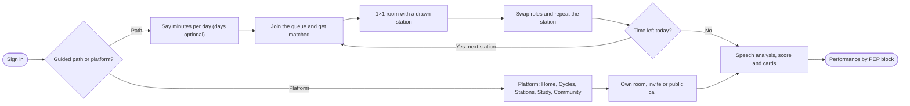
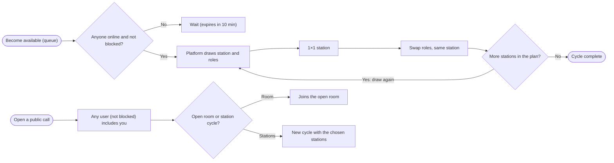
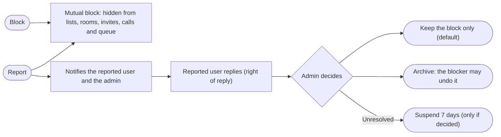
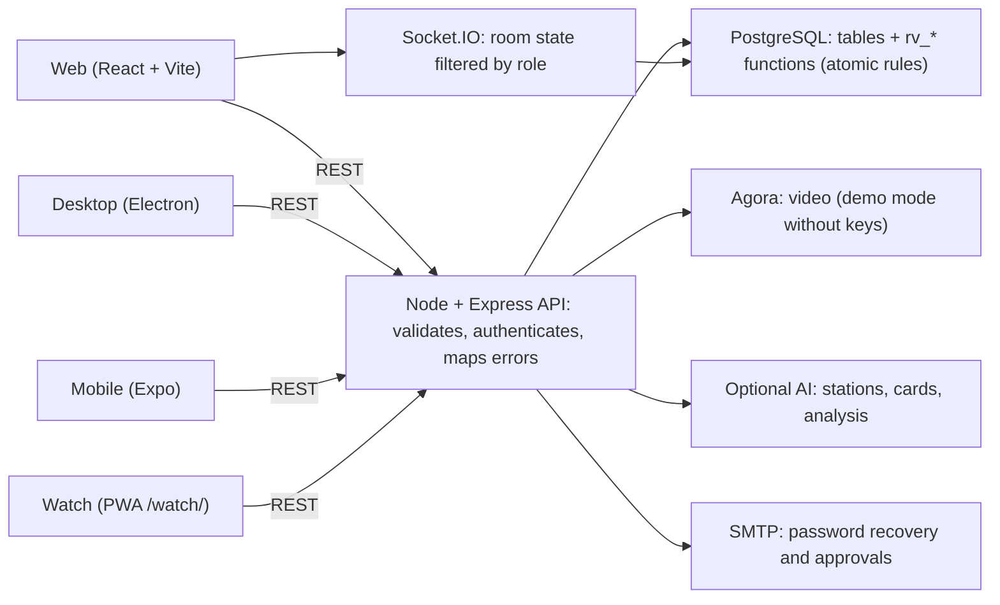

# Revalida Prático Playbook

_Manuals, journey, architecture, data and roadmap in one place_

> Honesty: everything here was tested in a development environment (real Postgres, automated browser). It was not tested in production, with live video, SMTP, real AI, Docker or native apps. See "What was and was not tested".

## In this playbook

- [Overview](#visao)
- [Manual map](#manuais)
- [End-to-end journey (UX)](#jornada)
- [Guided path](#trilha)
- [Random cycle and community call](#randomico)
- [Social safety: block and report](#seguranca)
- [Performance charts](#desempenho)
- [Architecture and operation](#arquitetura)
- [Installation and operations (summary)](#instalacao)
- [Business and investor (summary)](#negocio)
- [What was and was not tested](#testes)
- [Interactive roadmap](#roadmap)

## Overview

Revalida Prático is a platform for practising the Revalida practical stations: video rooms with a chief/evaluator, a candidate and observers; a checklist (PEP) scored on the server; speech analysis; flashcard study; and now a guided path, random cycles, a community and performance charts.

- Everything that decides access or score is checked on the server/database, never on the client.
- Room rules live in PostgreSQL functions (atomic); the API validates, translates errors and broadcasts state in real time.
- The cognitive aid (2D/3D conduct graph) can be switched off by the room chief to simulate the real exam.

## Manual map

This playbook integrates the five manuals. Each one remains the full reference for its audience:

- **User** (docs/01): first access, rooms, stations, study, account, FAQ.
- **Developer** (docs/02): repository, environment, modules, database, tests, recipes.
- **Investor and business plan** (docs/03): problem, market, model, projections, risks, roadmap.
- **Technical** (docs/04): architecture, authorization, session, real time, security, operations, limitations.
- **Installation** (docs/05) + **data model** and **API reference** (149 routes).

## End-to-end journey (UX)

On entry, the first question is simple: **guided path** or **platform**. Choosing the platform opens the app as usual. Choosing the path lets the platform drive the practice. The flowchart shows the whole route, including safety and feedback.

### End-to-end journey (UX)

## Guided path

- The first time, the person only says **how much time they have per day**; **weekdays are optional** (no choice = every day).
- In a later session the app asks again: **follow the path** (which recovers the saved setup) or **open the platform**.
- When following, the path computes the time **still missing today** (minutes of finished stations, São Paulo time zone) and joins the random queue; the room draws stations until the **time is filled** (each station counts twice because roles swap).
- One station after another **in the same room**, with a partner drawn from those available. If today is not a training day, the app warns and lets you train anyway.

## Random cycle and community call

- **Random cycle:** the person becomes "available". When a partner exists, the platform **draws the station** and **draws the roles** (chief/evaluator × candidate). After the 1×1 station, roles **swap** and the **same station runs again**; then the next drawn station follows, with a new role draw.
- **Community call:** the person opens a public call. **Any user** may (a) **add them to one of their open rooms** or (b) **start a cycle straight away** with specific stations (the call's own or drawn ones).
- Matching requires being online, active, not suspended and **not blocked either way**; the first to claim a call gets it (no double inclusion).

### Random cycle and community call

## Social safety: block and report

- **Blocking** is two-way: the blocker and the blocked person **stop appearing to each other** (online list, invitations, calls, random queue, room entry). The blocked person is not told.
- **Reporting** does all of that and also **notifies the reported person and the administrator**. The reported person sees the reason and the account (**never who reported**) and has the **right to reply**.
- **Default:** only the two people stop relating. A **weekly suspension (7 days)** happens only if the matter is **not resolved** and the **administrator decides** (with a reason); the suspended session drops at once. Administrators are not suspended this way.
- The administrator can resolve keeping the separation, archive (the blocker may then unblock) or suspend (each new decision adds another week). Everything is audited.

### Social safety: block and report

## Performance charts

The **Performance** screen summarises the stations you did as a candidate, organised by the **generalised PEP blocks**: preparation, history taking, physical exam, hypothesis, complementary tests, management, communication, outcome (and "other").

- **Filters:** area, period (7/30/90 days, 1 year, overall or a date range) and **modality** (room, random cycle, path, community call).
- **Charts:** score per block (with failed critical items), weekly trend, by modality and by area; **"Where to focus"** points to the three weakest blocks; a **table view** serves screen readers.
- Mapping items to blocks is **heuristic** (section and description); items with no clue fall under "other". Old link-based sessions (legacy model) are not part of the blocks.

## Architecture and operation

- **Front end:** React 18 + Vite (web), Electron (desktop), Expo (mobile) and a watch PWA.
- **API:** Node 20, Express and Socket.IO; modules by topic (`salas`, `social`, `desempenho`, `estudo`, `estacoes`…).
- **Database:** PostgreSQL 16. Room/cycle/role transitions are `rv_*` functions that lock the room row (atomic).
- **Video:** Agora (demo mode without credentials). **AI:** optional, never in the front end.
- **Scale:** a single API instance (Socket.IO without adapter) — a known limit; the random queue polls the database every 3 s per person (no sockets).

### How it works: architecture

### ER diagram (entity-relationship)

1 = one · N = many · dashed line = relation through a link table

```mermaid
erDiagram
  trilhas ||--|| usuarios : "fk"
  chamados }o--|| usuarios : "fk"
  chamados }o--|| salas : "fk"
  notificacoes }o--|| usuarios : "fk"
  denuncias }o--|| usuarios : "fk"
  suspensoes }o--|| denuncias : "fk"
  suspensoes }o--|| usuarios : "fk"
  bloqueios }o--|| usuarios : "fk"
  convites_sala }o--|| salas : "fk"
  convites_sala }o--|| usuarios : "fk"
  sala_participantes }o--|| salas : "fk"
  sala_participantes }o--|| usuarios : "fk"
  salas }o--|| usuarios : "fk"
  salas ||--|| ciclos : "fk"
  ciclos }o--|| usuarios : "fk"
  usuario_estacao }o--|| usuarios : "fk"
  usuario_estacao }o--|| estacoes : "fk"
  cartoes }o--|| temas : "fk"
  cartoes }o--|| estacoes : "fk"
  cartoes }o--|| pep_itens : "fk"
  cartao_progresso }o--|| cartoes : "fk"
  cartao_progresso }o--|| usuarios : "fk"
  ciclos_randomicos ||--|| salas : "fk"
  execucoes }o--|| ciclos : "fk"
  execucoes }o--|| ciclo_itens : "fk"
  execucoes }o--|| usuarios : "fk"
  solicitacoes_papel }o--|| salas : "fk"
  solicitacoes_papel }o--|| usuarios : "fk"
  ciclo_itens }o--|| ciclos : "fk"
  ciclo_itens }o--|| estacoes : "fk"
  transcricoes }o--|| execucoes : "fk"
  analises_transcricao ||--|| execucoes : "fk"
  pep_itens }o--|| estacoes : "fk"
  estacao_temas }o--|| estacoes : "fk"
  estacao_temas }o--|| temas : "fk"
  trilhas {
    string usuario_id PK
    string minutos_dia
    string dias
    string ultimo_modo
  }
  chamados {
    string id PK
    string usuario_id FK
    string sala_id FK
    string tipo
    string area
  }
  notificacoes {
    string id PK
    string usuario_id FK
    string tipo
    string lida_em
  }
  denuncias {
    string id PK
    string denunciante_id FK
    string denunciado_id FK
    string motivo
    string resposta
  }
  suspensoes {
    string id PK
    string usuario_id FK
    string denuncia_id FK
    string inicio
  }
  bloqueios {
    string bloqueador_id PK
    string bloqueado_id PK
    string origem
  }
  convites_sala {
    string id PK
    string sala_id FK
    string convidante_id FK
    string convidado_id FK
    string estado
  }
  salas {
    string id PK
    string dono_id FK
    string ciclo_ativo_id FK
    string estado
    string apoio_cognitivo
  }
  sala_participantes {
    string sala_id PK
    string usuario_id PK
    string papel
    string entrou_em
  }
  usuarios {
    string id PK
    string nome
    string papel_app
    string suspenso_ate
  }
  usuario_estacao {
    string usuario_id PK
    string estacao_id PK
    string vezes_realizada
    string melhor_nota
  }
  cartoes {
    string id PK
    string tema_id FK
    string estacao_id FK
    string pep_item_id FK
    string frente
  }
  ciclos_randomicos {
    string sala_id PK
    string estacoes
    string indice
    string origem
  }
  ciclos {
    string id PK
    string sala_id FK
    string admin_id FK
    string candidato_id FK
    string estado
  }
  execucoes {
    string id PK
    string ciclo_id FK
    string candidato_id FK
    string avaliador_id FK
    string nota
  }
  estacoes {
    string id PK
    string titulo
    string duracao_min
    string status
  }
  cartao_progresso {
    string usuario_id PK
    string cartao_id PK
    string proximo_em
    string acertos
  }
  temas {
    string id PK
    string nome
    string relevancia
  }
  solicitacoes_papel {
    string id PK
    string sala_id FK
    string solicitante_id FK
    string papel_pedido
  }
  ciclo_itens {
    string id PK
    string ciclo_id FK
    string estacao_id FK
    string posicao
  }
  transcricoes {
    string id PK
    string execucao_id FK
    string texto
  }
  pep_itens {
    string id PK
    string estacao_id FK
    string secao
    string pontos_total
  }
  analises_transcricao {
    string execucao_id PK
    string itens
    string gerada_em
  }
  estacao_temas {
    string estacao_id PK
    string tema_id PK
  }
```

## Installation and operations (summary)

- **Docker:** `bash scripts/instalar.sh --url https://your-domain` creates a safe `.env`, starts database/API/web and prints the installer code.
- **Without Docker:** `psql -f db/schema.sql` (idempotent; includes migration 013), `npm install --omit=dev` and `npm start` for the API; `npm run build` for the web.
- **Update:** `bash scripts/atualizar.sh` (backup → ordered migrations → rebuild). **HTTPS is mandatory** for camera and microphone.
- Before opening to the public, run the guide's smoke test (30 min), including: two accounts matching in the queue, one block and one report end to end.

## Business and investor (summary)

- **Problem:** Revalida practical training needs partners, evaluators and structured feedback, which are hard to gather.
- **Solution:** rooms with server-scored PEP, speech analysis, study, and now **automatic matching** (path/random) and a **moderated community**, which tackle the partner shortage.
- **Model:** subscriptions and per-exam-edition packs, B2B for courses and institutions *(prices are hypotheses, to be validated in the pilot)*.
- **Key risks:** intellectual property (INEP), data protection (voice/video), clinical error in content/AI, technical maturity not validated in production. **Never promise approval.**
- Details, projections and sources: Investor Manual (docs/03).

## What was and was not tested

**Tested (development, real Postgres 16):** automated server tests (room rules, invitations, execution, study, catalogue, dashboard, **social**, **performance**), web tests (conduct engine, 3D graph, device) and end-to-end tests in Chromium (rooms, execution, cognitive aid, study, **path, community, block/report and charts**). The schema and migrations were applied twice on a clean database.

**Not tested:** real `npm install` and `docker compose up` (network and daemon unavailable in the environment), the real Vite build, live video (Agora), email (SMTP), real AI, Electron, Expo, load/stress and **several real users on real devices**. The random queue and moderation were verified with simulated accounts.

**Known limits:** PEP block classification is heuristic; "online" = seen in the last 90 s; queue matching polls the database (no sockets); moderation is manual (no SLA or metrics dashboard).

## Interactive roadmap

| Phase · track | Milestone | Status |
|---|---|---|
| Today · Platform | **Rooms, cycles and roles** — Chief, candidate and observers; station queue; role swap; pause and resume; online invitations; atomic PostgreSQL rules. | Delivered (tested in development) |
| Today · Content | **Stations, study and speech analysis** — Create, import (PDF) and review stations; cards and study path; live transcription and self-correction; analysis boards. | Delivered (tested in development) |
| Today · Product | **2D/3D cognitive aid** — Dynamic conduct graph (findings → hypothesis → tests → management), movable and resizable board, 3D conversion, switchable off by the chief. | Delivered (tested in development) |
| Today · Business | **Manuals, package and gallery** — Five manuals, an installation package with SHA-256 check, a visual gallery and this playbook in four languages. | Delivered (tested in development) |
| This release · Product | **Community, path and social safety** — Path × platform choice, random cycle with 1×1 swap, public call, block and report with right of reply and weekly suspension, charts by PEP block. Still to validate with real users. | Delivered, still to validate in production |
| 0–3 months · Platform | **Validate in a real environment** — Docker on staging, real Agora, real AI, SMTP, a user pilot, privacy policy and consent (data protection), load test of the random queue. | Next |
| 3–6 months · Content | **Clinical curation and cohorts** — Specialists review stations and cognitive-aid protocols; cohort dashboard (B2B); report export; moderation workflow with deadlines and metrics. | Next |
| 6–12 months · Platform | **Scale and monetisation** — Payments and plans, Socket.IO adapter (several replicas), metrics and alerts, event-driven random queue, native apps published. | Next |
| 12+ months · Business | **Ecosystem** — Evaluator pool, topic reports for institutions, other practical exams and more languages. | Next |

_Single source: docs/playbook/conteudo.py. Built by docs/playbook/gerar.py._
