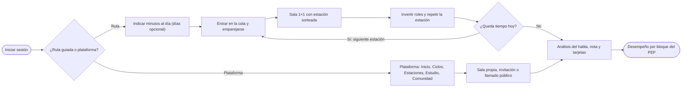
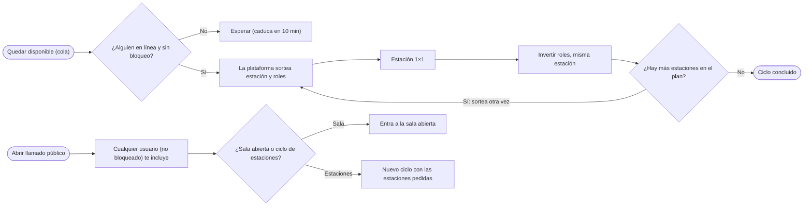
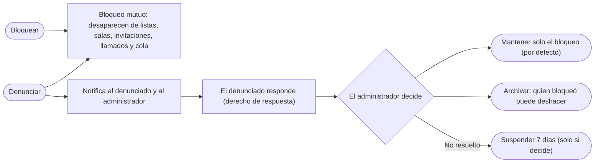
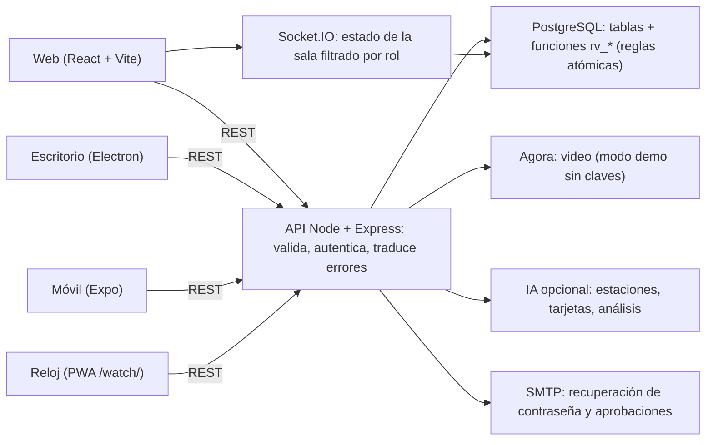

# Playbook Revalida Prático

_Manuales, recorrido, arquitectura, datos y hoja de ruta en un solo lugar_

> Honestidad: todo se probó en un entorno de desarrollo (Postgres real, navegador automatizado). No se probó en producción, con video en vivo, SMTP, IA real, Docker ni apps nativas. Vea la sección «Qué se probó y qué no».

## En este playbook

- [Visión general](#visao)
- [Mapa de los manuales](#manuais)
- [Recorrido de extremo a extremo (UX)](#jornada)
- [Ruta guiada](#trilha)
- [Ciclo aleatorio y llamado a la comunidad](#randomico)
- [Seguridad social: bloquear y denunciar](#seguranca)
- [Retroalimentación gráfica de desempeño](#desempenho)
- [Arquitectura y funcionamiento](#arquitetura)
- [Instalación y operación (resumen)](#instalacao)
- [Negocio e inversor (resumen)](#negocio)
- [Qué se probó y qué no](#testes)
- [Hoja de ruta interactiva](#roadmap)

## Visión general

Revalida Prático es una plataforma para entrenar las estaciones prácticas del Revalida: salas por video con jefe/evaluador, candidato y observadores; lista de verificación (PEP) con nota calculada en el servidor; análisis del habla; estudio con tarjetas; y ahora ruta guiada, ciclo aleatorio, comunidad y gráficos de desempeño.

- Todo lo que decide acceso y nota se verifica en el servidor/base de datos, nunca en el cliente.
- Las reglas de las salas viven en funciones de PostgreSQL (atómicas); la API valida, traduce errores y difunde el estado en tiempo real.
- El apoyo cognitivo (grafo 2D/3D de la conducta) puede ser desactivado por el jefe para simular el examen.

## Mapa de los manuales

Este playbook integra los cinco manuales. Cada uno sigue siendo la referencia completa para su público:

- **Usuario** (docs/01): primer acceso, salas, estaciones, estudio, cuenta, preguntas frecuentes.
- **Desarrollador** (docs/02): repositorio, entorno, módulos, base de datos, pruebas, recetas.
- **Inversor y plan de negocios** (docs/03): problema, mercado, modelo, proyecciones, riesgos, hoja de ruta.
- **Técnico** (docs/04): arquitectura, autorización, sesión, tiempo real, seguridad, operación, limitaciones.
- **Instalación** (docs/05) + **modelo de datos** y **referencia de la API** (149 rutas).

## Recorrido de extremo a extremo (UX)

Al entrar, la primera pregunta es simple: **ruta guiada** o **plataforma**. Si elige la plataforma, la app se abre como siempre. Si elige la ruta, la plataforma conduce el entrenamiento. El diagrama muestra el camino completo, incluidas la seguridad y la retroalimentación.

### Recorrido de extremo a extremo (UX)

## Ruta guiada

- La primera vez la persona solo indica **cuánto tiempo tiene por día**; los **días de la semana son opcionales** (sin elección = todos los días).
- En otra sesión la app vuelve a preguntar: **seguir la ruta** (que recupera lo configurado) o **acceder a la plataforma**.
- Al seguir, la ruta calcula el tiempo que **falta hoy** (minutos de estaciones finalizadas, en la zona horaria de São Paulo) y entra en la fila aleatoria; la sala sortea estaciones hasta **llenar el tiempo** (cada estación cuenta 2×, porque los roles se invierten).
- Una estación tras otra, **dentro de la misma sala**, con pareja sorteada entre los disponibles. Si hoy no es día de entrenamiento, la app avisa y permite entrenar de todos modos.

## Ciclo aleatorio y llamado a la comunidad

- **Ciclo aleatorio:** la persona queda «disponible». Cuando hay pareja, la plataforma **sortea la estación** y **sortea los roles** (jefe/evaluador × candidato). Terminada la estación 1×1, los roles **se invierten** y la **misma estación se repite**; luego viene la siguiente estación sorteada, con nuevo sorteo de roles.
- **Llamado a la comunidad:** la persona abre un llamado público. **Cualquier usuario** puede (a) **incluirla en una sala abierta** suya o (b) **iniciar directamente un ciclo** de estaciones específicas (las del llamado o sorteadas).
- El emparejamiento exige estar en línea, activo, no suspendido y **sin bloqueo entre ambos**; el primero en reclamar un llamado lo obtiene (sin doble inclusión).

### Ciclo aleatorio y llamado a la comunidad

## Seguridad social: bloquear y denunciar

- **Bloquear** es bilateral: quien bloqueó y quien fue bloqueado **dejan de aparecer el uno para el otro** (lista en línea, invitaciones, llamados, fila aleatoria, entrada a salas). El bloqueado no es avisado.
- **Denunciar** hace todo eso y además **notifica al denunciado y al administrador**. El denunciado ve el motivo y el relato (**nunca quién denunció**) y tiene **derecho de respuesta**.
- **Por defecto:** solo esas dos personas dejan de relacionarse. Una **suspensión semanal (7 días)** solo ocurre si la situación **no se resuelve** y el **administrador decide** (con justificación); la sesión del suspendido cae de inmediato. Los administradores no se suspenden por esta vía.
- El administrador puede: resolver manteniendo el alejamiento, archivar (quien bloqueó podrá desbloquear) o suspender (cada decisión nueva suma otra semana). Todo queda en la auditoría.

### Seguridad social: bloquear y denunciar

## Retroalimentación gráfica de desempeño

La pantalla **Desempeño** resume las estaciones hechas como candidato, organizadas por los **bloques generalizados del PEP**: preparación, anamnesis, examen físico, hipótesis, exámenes complementarios, conducta, comunicación, desenlace (y «otros»).

- **Filtros:** área, período (7/30/90 días, 1 año, general o rango de fechas) y **modalidad** (sala, ciclo aleatorio, ruta, llamado de la comunidad).
- **Gráficos:** aprovechamiento por bloque (con críticos fallidos), evolución semanal, por modalidad y por área; **«Dónde enfocarse»** señala los tres bloques más débiles; hay **vista en tabla** para lectores de pantalla.
- La clasificación de los ítems en bloques es **heurística** (sección y descripción); los ítems sin pista caen en «otros». Las estaciones antiguas por enlace (modelo heredado) no entran en los bloques.

## Arquitectura y funcionamiento

- **Front:** React 18 + Vite (web), Electron (escritorio), Expo (móvil) y PWA para reloj.
- **API:** Node 20, Express y Socket.IO; módulos por tema (`salas`, `social`, `desempenho`, `estudo`, `estacoes`…).
- **Base de datos:** PostgreSQL 16. Las transiciones de sala/ciclo/rol son funciones `rv_*` que bloquean la fila de la sala (atómicas).
- **Video:** Agora (modo demostración sin credenciales). **IA:** opcional, nunca en el front-end.
- **Escala:** una sola instancia de API (Socket.IO sin adaptador) — límite conocido; la fila aleatoria consulta la base cada 3 s por persona (no usa sockets).

### Funcionamiento: arquitectura

### Diagrama MER (entidad-relación)

1 = uno · N = muchos · línea punteada = relación mediante tabla auxiliar

```mermaid
erDiagram
  trilhas ||--|| usuarios : "fk"
  chamados }o--|| usuarios : "fk"
  chamados }o--|| salas : "fk"
  notificacoes }o--|| usuarios : "fk"
  denuncias }o--|| usuarios : "fk"
  suspensoes }o--|| denuncias : "fk"
  suspensoes }o--|| usuarios : "fk"
  bloqueios }o--|| usuarios : "fk"
  convites_sala }o--|| salas : "fk"
  convites_sala }o--|| usuarios : "fk"
  sala_participantes }o--|| salas : "fk"
  sala_participantes }o--|| usuarios : "fk"
  salas }o--|| usuarios : "fk"
  salas ||--|| ciclos : "fk"
  ciclos }o--|| usuarios : "fk"
  usuario_estacao }o--|| usuarios : "fk"
  usuario_estacao }o--|| estacoes : "fk"
  cartoes }o--|| temas : "fk"
  cartoes }o--|| estacoes : "fk"
  cartoes }o--|| pep_itens : "fk"
  cartao_progresso }o--|| cartoes : "fk"
  cartao_progresso }o--|| usuarios : "fk"
  ciclos_randomicos ||--|| salas : "fk"
  execucoes }o--|| ciclos : "fk"
  execucoes }o--|| ciclo_itens : "fk"
  execucoes }o--|| usuarios : "fk"
  solicitacoes_papel }o--|| salas : "fk"
  solicitacoes_papel }o--|| usuarios : "fk"
  ciclo_itens }o--|| ciclos : "fk"
  ciclo_itens }o--|| estacoes : "fk"
  transcricoes }o--|| execucoes : "fk"
  analises_transcricao ||--|| execucoes : "fk"
  pep_itens }o--|| estacoes : "fk"
  estacao_temas }o--|| estacoes : "fk"
  estacao_temas }o--|| temas : "fk"
  trilhas {
    string usuario_id PK
    string minutos_dia
    string dias
    string ultimo_modo
  }
  chamados {
    string id PK
    string usuario_id FK
    string sala_id FK
    string tipo
    string area
  }
  notificacoes {
    string id PK
    string usuario_id FK
    string tipo
    string lida_em
  }
  denuncias {
    string id PK
    string denunciante_id FK
    string denunciado_id FK
    string motivo
    string resposta
  }
  suspensoes {
    string id PK
    string usuario_id FK
    string denuncia_id FK
    string inicio
  }
  bloqueios {
    string bloqueador_id PK
    string bloqueado_id PK
    string origem
  }
  convites_sala {
    string id PK
    string sala_id FK
    string convidante_id FK
    string convidado_id FK
    string estado
  }
  salas {
    string id PK
    string dono_id FK
    string ciclo_ativo_id FK
    string estado
    string apoio_cognitivo
  }
  sala_participantes {
    string sala_id PK
    string usuario_id PK
    string papel
    string entrou_em
  }
  usuarios {
    string id PK
    string nome
    string papel_app
    string suspenso_ate
  }
  usuario_estacao {
    string usuario_id PK
    string estacao_id PK
    string vezes_realizada
    string melhor_nota
  }
  cartoes {
    string id PK
    string tema_id FK
    string estacao_id FK
    string pep_item_id FK
    string frente
  }
  ciclos_randomicos {
    string sala_id PK
    string estacoes
    string indice
    string origem
  }
  ciclos {
    string id PK
    string sala_id FK
    string admin_id FK
    string candidato_id FK
    string estado
  }
  execucoes {
    string id PK
    string ciclo_id FK
    string candidato_id FK
    string avaliador_id FK
    string nota
  }
  estacoes {
    string id PK
    string titulo
    string duracao_min
    string status
  }
  cartao_progresso {
    string usuario_id PK
    string cartao_id PK
    string proximo_em
    string acertos
  }
  temas {
    string id PK
    string nome
    string relevancia
  }
  solicitacoes_papel {
    string id PK
    string sala_id FK
    string solicitante_id FK
    string papel_pedido
  }
  ciclo_itens {
    string id PK
    string ciclo_id FK
    string estacao_id FK
    string posicao
  }
  transcricoes {
    string id PK
    string execucao_id FK
    string texto
  }
  pep_itens {
    string id PK
    string estacao_id FK
    string secao
    string pontos_total
  }
  analises_transcricao {
    string execucao_id PK
    string itens
    string gerada_em
  }
  estacao_temas {
    string estacao_id PK
    string tema_id PK
  }
```

## Instalación y operación (resumen)

- **Docker:** `bash scripts/instalar.sh --url https://su-dominio` genera el `.env` seguro, levanta base/API/web e imprime el código del instalador.
- **Sin Docker:** `psql -f db/schema.sql` (idempotente; incluye la migración 013), `npm install --omit=dev` y `npm start` en la API; `npm run build` en la web.
- **Actualizar:** `bash scripts/atualizar.sh` (copia → migraciones en orden → rebuild). **HTTPS es obligatorio** para cámara y micrófono.
- Antes de abrir al público, haga la prueba de humo de la guía (30 min), incluyendo: dos cuentas emparejándose en la fila, un bloqueo y una denuncia de extremo a extremo.

## Negocio e inversor (resumen)

- **Problema:** el entrenamiento práctico del Revalida exige compañeros, evaluadores y retroalimentación estructurada, difíciles de reunir.
- **Solución:** salas con PEP calculado en el servidor, análisis del habla, estudio y ahora **emparejamiento automático** (ruta/aleatorio) y **comunidad moderada**, que atacan la falta de pareja.
- **Modelo:** suscripciones y paquetes por convocatoria, B2B para cursos e instituciones *(los precios son hipótesis, por validar en el piloto)*.
- **Riesgos clave:** propiedad intelectual (INEP), protección de datos (voz/video), error clínico en contenido/IA, madurez técnica no validada en producción. **Nunca prometer aprobación.**
- Detalles, proyecciones y fuentes: Manual del Inversor (docs/03).

## Qué se probó y qué no

**Probado (desarrollo, Postgres 16 real):** pruebas automatizadas del servidor (reglas de salas, invitaciones, ejecución, estudio, catálogo, panel, **social**, **desempeño**), pruebas web (motor de conducta, grafo 3D, dispositivo) y pruebas de extremo a extremo en Chromium (salas, ejecución, apoyo cognitivo, estudio, **ruta, comunidad, bloqueo/denuncia y gráficos**). El esquema y las migraciones se aplicaron dos veces en una base limpia.

**No probado:** `npm install` real y `docker compose up` (red y daemon no disponibles en el entorno), build real de Vite, video en vivo (Agora), correo (SMTP), IA real, Electron, Expo, carga/estrés y **varios usuarios reales en dispositivos reales**. La fila aleatoria y la moderación se verificaron con cuentas simuladas.

**Límites conocidos:** la clasificación de bloques del PEP es heurística; «en línea» = visto en los últimos 90 s; el emparejamiento consulta la base (sin sockets); la moderación es manual (sin SLA ni panel de métricas).

## Hoja de ruta interactiva

| Fase · línea | Hito | Estado |
|---|---|---|
| Hoy · Plataforma | **Salas, ciclos y roles** — Jefe, candidato y observadores; fila de estaciones; inversión de roles; pausa y reanudación; invitaciones en línea; reglas atómicas en PostgreSQL. | Entregado (probado en desarrollo) |
| Hoy · Contenido | **Estaciones, estudio y análisis del habla** — Crear, importar (PDF) y revisar estaciones; tarjetas y ruta de estudio; transcripción en vivo y autocorrección; paneles de análisis. | Entregado (probado en desarrollo) |
| Hoy · Producto | **Apoyo cognitivo 2D/3D** — Grafo dinámico de la conducta (hallazgos → hipótesis → exámenes → conducta), panel móvil y redimensionable, conversión a 3D, desactivable por el jefe. | Entregado (probado en desarrollo) |
| Hoy · Negocio | **Manuales, paquete y galería** — Cinco manuales, paquete de instalación con verificación SHA-256, galería visual y este playbook en cuatro idiomas. | Entregado (probado en desarrollo) |
| Esta versión · Producto | **Comunidad, ruta y seguridad social** — Elección ruta × plataforma, ciclo aleatorio con inversión 1×1, llamado público, bloqueo y denuncia con derecho de respuesta y suspensión semanal, gráficos por bloque del PEP. Falta validar con usuarios reales. | Entregado, falta validar en producción |
| 0–3 meses · Plataforma | **Validar en entorno real** — Docker en staging, Agora real, IA real, SMTP, piloto con usuarios, política de privacidad y consentimiento (protección de datos), prueba de carga de la fila aleatoria. | Próximo |
| 3–6 meses · Contenido | **Curaduría clínica y grupos** — Especialistas revisan estaciones y protocolos del apoyo cognitivo; panel de grupo (B2B); exportación de informes; flujo de moderación con plazos y métricas. | Próximo |
| 6–12 meses · Plataforma | **Escala y monetización** — Pagos y planes, adaptador Socket.IO (varias réplicas), métricas y alertas, fila aleatoria por eventos, apps nativas publicadas. | Próximo |
| 12+ meses · Negocio | **Ecosistema** — Banco de evaluadores, informes por tema para instituciones, otros exámenes prácticos y nuevos idiomas. | Próximo |

_Fuente única: docs/playbook/conteudo.py. Generado por docs/playbook/gerar.py._
