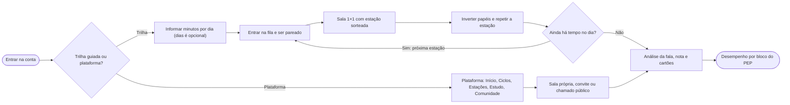
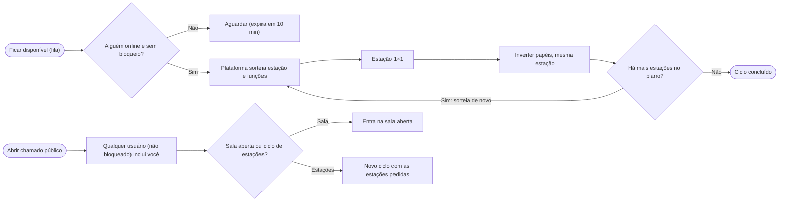
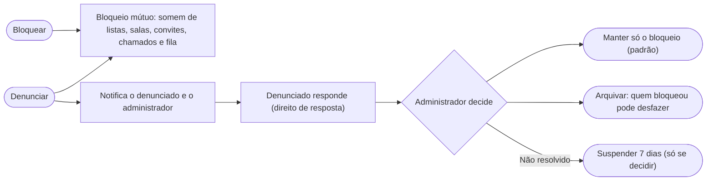
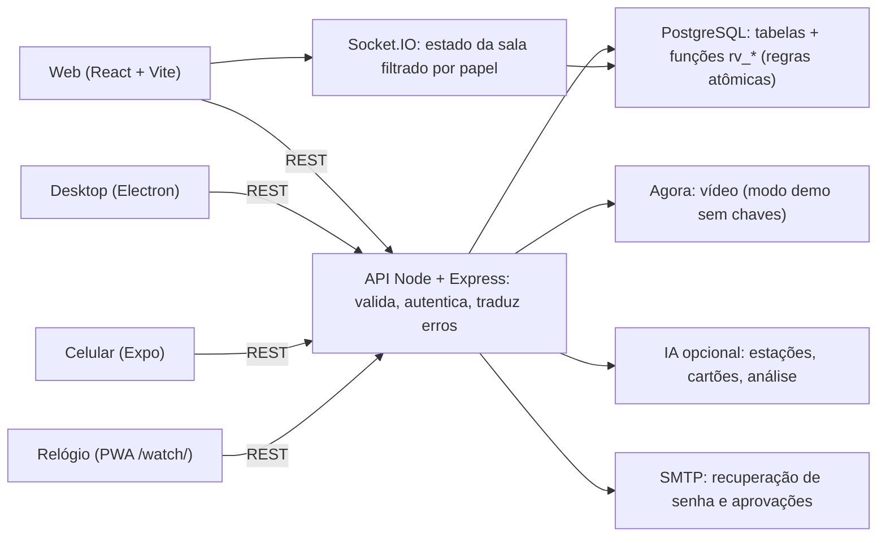

# Playbook Revalida Prático

_Manuais, jornada, arquitetura, dados e roadmap em um só lugar_

> Honestidade: tudo aqui foi testado em ambiente de desenvolvimento (Postgres real, navegador automatizado). Não foi testado em produção, com vídeo ao vivo, SMTP, IA real, Docker nem apps nativos. Veja a seção "O que foi e não foi testado".

## Neste playbook

- [Visão geral](#visao)
- [Mapa dos manuais](#manuais)
- [Jornada ponta a ponta (UX)](#jornada)
- [Trilha guiada](#trilha)
- [Ciclo randômico e chamado à comunidade](#randomico)
- [Segurança social: bloquear e denunciar](#seguranca)
- [Prática solo, cartas, podcast e Rádio Revalida](#radio)
- [Feedback gráfico de desempenho](#desempenho)
- [Arquitetura e funcionamento](#arquitetura)
- [Instalação e operação (resumo)](#instalacao)
- [Negócio e investidor (resumo)](#negocio)
- [O que foi e não foi testado](#testes)
- [Roadmap interativo](#roadmap)

## Visão geral

O Revalida Prático é uma plataforma para treinar as estações práticas do Revalida: salas por vídeo com chefe/avaliador, candidato e observadores; checklist (PEP) com nota calculada no servidor; análise da fala; estudo com cartões; e agora trilha guiada, ciclo randômico, comunidade e gráficos de desempenho.

- Tudo que decide acesso e nota é conferido no servidor/banco, nunca no cliente.
- As regras das salas vivem em funções do PostgreSQL (atômicas); a API valida, traduz erros e difunde o estado em tempo real.
- O apoio cognitivo (grafo 2D/3D da conduta) pode ser desligado pelo chefe para simular a prova.

## Mapa dos manuais

Este playbook integra os cinco manuais. Cada um continua sendo a referência completa do seu público:

- **Usuário** (docs/01): primeiro acesso, salas, estações, estudo, conta, perguntas frequentes.
- **Desenvolvedor** (docs/02): repositório, ambiente, módulos, banco, testes, receitas.
- **Investidor e plano de negócios** (docs/03): problema, mercado, modelo, projeções, riscos, roadmap.
- **Técnico** (docs/04): arquitetura, autorização, sessão, tempo real, segurança, operação, limitações.
- **Instalação** (docs/05) + **modelo de dados** e **referência da API** (149 rotas).

## Jornada ponta a ponta (UX)

Ao entrar, a primeira pergunta é simples: **trilha guiada** ou **plataforma**. Escolhendo a plataforma, o app abre como sempre. Escolhendo a trilha, a plataforma conduz o treino. O fluxograma mostra o caminho completo, inclusive segurança e feedback.

### Jornada ponta a ponta (UX)

## Trilha guiada

- Na primeira vez a pessoa só informa **quanto tempo tem por dia**; os **dias da semana são opcionais** (sem escolha = todos os dias).
- Em outra sessão, o app pergunta de novo: **seguir a trilha** (que recupera o que foi configurado) ou **acessar a plataforma**.
- Ao seguir, a trilha calcula o tempo que **falta hoje** (minutos de estações finalizadas, no fuso de São Paulo) e entra na fila randômica; a sala sorteia estações até **preencher o tempo** (cada estação conta 2×, pois os papéis se invertem).
- Uma estação após a outra, **dentro da mesma sala**, com parceiro sorteado entre os disponíveis. Se não é dia de treino, o app avisa e permite treinar mesmo assim.

## Ciclo randômico e chamado à comunidade

- **Ciclo randômico:** a pessoa fica "disponível". Quando há par, a plataforma **sorteia a estação** e **sorteia as funções** (chefe/avaliador × candidato). Terminada a estação 1×1, as funções **se invertem** e a **mesma estação roda de novo**; depois vem a próxima estação sorteada, com novo sorteio de funções.
- **Chamado à comunidade:** a pessoa abre um chamado público. **Qualquer usuário** pode (a) **incluí-la numa sala aberta** dele ou (b) **iniciar direto um ciclo** de estações específicas (as do chamado ou sorteadas).
- Pareamento exige estar online, ativo, não suspenso e **sem bloqueio entre os dois**; o primeiro a reivindicar um chamado o leva (sem dupla inclusão).

### Ciclo randômico e chamado à comunidade

## Segurança social: bloquear e denunciar

- **Bloquear** é bilateral: quem bloqueou e quem foi bloqueado **deixam de aparecer um para o outro** (lista online, convites, chamados, fila randômica, entrada em salas). Quem foi bloqueado não é avisado.
- **Denunciar** faz tudo isso e ainda **notifica o denunciado e o administrador**. O denunciado vê o motivo e o relato (**nunca quem denunciou**) e tem **direito de resposta**.
- **Padrão:** só os dois deixam de se relacionar. Uma **suspensão semanal (7 dias)** só acontece se a situação **não for resolvida** e o **administrador decidir** (com justificativa); a sessão do suspenso cai na hora. Administradores não são suspensos por essa via.
- O administrador pode: resolver mantendo o afastamento, arquivar (o bloqueador passa a poder desbloquear) ou suspender (cada decisão nova soma outra semana). Tudo fica na auditoria.

### Segurança social: bloquear e denunciar

## Prática solo, cartas, podcast e Rádio Revalida

- **Praticar com IA:** a IA sorteia o tema na área de maior necessidade; você escolhe só dificuldade e tempo (padrão: tempo da estação, médio, 15 itens).
- **Cartas:** cada cartão vira uma carta de RPG; a lista mostra todos, 10 por página, por área; o assistente transforma um tema em cartas.
- **Podcast:** playlists de áudio com transcrição, prompt de detalhamento, pausa e continuação, link privado (sua credencial) ou público para apps de podcast.
- **Rádio Revalida (radIA.m3d):** episódios públicos entram no programa; temas exportados ficam num pool com a data da solicitação até a sincronização.

## Feedback gráfico de desempenho

A tela **Desempenho** resume as estações feitas como candidato, organizadas pelos **blocos generalizados do PEP**: preparação, anamnese, exame físico, hipótese, exames complementares, conduta, comunicação, desfecho (e "outros").

- **Filtros:** área, período (7/30/90 dias, 1 ano, geral ou intervalo de datas) e **modalidade** (sala, ciclo randômico, trilha, chamado da comunidade).
- **Gráficos:** aproveitamento por bloco (com críticos falhos), evolução semanal, por modalidade e por área; **"Onde focar"** aponta os três blocos mais fracos; há **visão em tabela** para leitores de tela.
- A classificação dos itens em blocos é **heurística** (seção e descrição); itens sem pista caem em "outros". Estações antigas por link (modelo legado) não entram nos blocos.

## Arquitetura e funcionamento

- **Front:** React 18 + Vite (web), Electron (desktop), Expo (celular) e PWA para relógio.
- **API:** Node 20, Express e Socket.IO; módulos por assunto (`salas`, `social`, `desempenho`, `estudo`, `estacoes`…).
- **Banco:** PostgreSQL 16. As transições de sala/ciclo/papel são funções `rv_*` que travam a linha da sala (atômicas).
- **Vídeo:** Agora (modo demonstração sem credenciais). **IA:** opcional, nunca no front-end.
- **Escala:** instância única de API (Socket.IO sem adaptador) — limite conhecido; a fila randômica consulta o banco a cada 3 s por pessoa (não usa sockets).

### Funcionamento: arquitetura

### Diagrama MER (entidade-relacionamento)

1 = um · N = muitos · linha tracejada = relação por tabela auxiliar

```mermaid
erDiagram
  trilhas ||--|| usuarios : "fk"
  chamados }o--|| usuarios : "fk"
  chamados }o--|| salas : "fk"
  notificacoes }o--|| usuarios : "fk"
  denuncias }o--|| usuarios : "fk"
  suspensoes }o--|| denuncias : "fk"
  suspensoes }o--|| usuarios : "fk"
  bloqueios }o--|| usuarios : "fk"
  convites_sala }o--|| salas : "fk"
  convites_sala }o--|| usuarios : "fk"
  sala_participantes }o--|| salas : "fk"
  sala_participantes }o--|| usuarios : "fk"
  salas }o--|| usuarios : "fk"
  salas ||--|| ciclos : "fk"
  ciclos }o--|| usuarios : "fk"
  usuario_estacao }o--|| usuarios : "fk"
  usuario_estacao }o--|| estacoes : "fk"
  cartoes }o--|| temas : "fk"
  cartoes }o--|| estacoes : "fk"
  cartoes }o--|| pep_itens : "fk"
  cartao_progresso }o--|| cartoes : "fk"
  cartao_progresso }o--|| usuarios : "fk"
  ciclos_randomicos ||--|| salas : "fk"
  execucoes }o--|| ciclos : "fk"
  execucoes }o--|| ciclo_itens : "fk"
  execucoes }o--|| usuarios : "fk"
  solicitacoes_papel }o--|| salas : "fk"
  solicitacoes_papel }o--|| usuarios : "fk"
  ciclo_itens }o--|| ciclos : "fk"
  ciclo_itens }o--|| estacoes : "fk"
  transcricoes }o--|| execucoes : "fk"
  analises_transcricao ||--|| execucoes : "fk"
  pep_itens }o--|| estacoes : "fk"
  estacao_temas }o--|| estacoes : "fk"
  estacao_temas }o--|| temas : "fk"
  trilhas {
    string usuario_id PK
    string minutos_dia
    string dias
    string ultimo_modo
  }
  chamados {
    string id PK
    string usuario_id FK
    string sala_id FK
    string tipo
    string area
  }
  notificacoes {
    string id PK
    string usuario_id FK
    string tipo
    string lida_em
  }
  denuncias {
    string id PK
    string denunciante_id FK
    string denunciado_id FK
    string motivo
    string resposta
  }
  suspensoes {
    string id PK
    string usuario_id FK
    string denuncia_id FK
    string inicio
  }
  bloqueios {
    string bloqueador_id PK
    string bloqueado_id PK
    string origem
  }
  convites_sala {
    string id PK
    string sala_id FK
    string convidante_id FK
    string convidado_id FK
    string estado
  }
  salas {
    string id PK
    string dono_id FK
    string ciclo_ativo_id FK
    string estado
    string apoio_cognitivo
  }
  sala_participantes {
    string sala_id PK
    string usuario_id PK
    string papel
    string entrou_em
  }
  usuarios {
    string id PK
    string nome
    string papel_app
    string suspenso_ate
  }
  usuario_estacao {
    string usuario_id PK
    string estacao_id PK
    string vezes_realizada
    string melhor_nota
  }
  cartoes {
    string id PK
    string tema_id FK
    string estacao_id FK
    string pep_item_id FK
    string frente
  }
  ciclos_randomicos {
    string sala_id PK
    string estacoes
    string indice
    string origem
  }
  ciclos {
    string id PK
    string sala_id FK
    string admin_id FK
    string candidato_id FK
    string estado
  }
  execucoes {
    string id PK
    string ciclo_id FK
    string candidato_id FK
    string avaliador_id FK
    string nota
  }
  estacoes {
    string id PK
    string titulo
    string duracao_min
    string status
  }
  cartao_progresso {
    string usuario_id PK
    string cartao_id PK
    string proximo_em
    string acertos
  }
  temas {
    string id PK
    string nome
    string relevancia
  }
  solicitacoes_papel {
    string id PK
    string sala_id FK
    string solicitante_id FK
    string papel_pedido
  }
  ciclo_itens {
    string id PK
    string ciclo_id FK
    string estacao_id FK
    string posicao
  }
  transcricoes {
    string id PK
    string execucao_id FK
    string texto
  }
  pep_itens {
    string id PK
    string estacao_id FK
    string secao
    string pontos_total
  }
  analises_transcricao {
    string execucao_id PK
    string itens
    string gerada_em
  }
  estacao_temas {
    string estacao_id PK
    string tema_id PK
  }
```

## Instalação e operação (resumo)

- **Docker:** `bash scripts/instalar.sh --url https://seu-dominio` gera o `.env` seguro, sobe banco/API/web e imprime o código do instalador.
- **Sem Docker:** `psql -f db/schema.sql` (idempotente; inclui a migração 013), `npm install --omit=dev` e `npm start` na API; `npm run build` na web.
- **Atualizar:** `bash scripts/atualizar.sh` (backup → migrações em ordem → rebuild). **HTTPS é obrigatório** para câmera e microfone.
- Antes de abrir ao público, faça o smoke test do guia (30 min), incluindo: duas contas pareando na fila, um bloqueio e uma denúncia de ponta a ponta.

## Negócio e investidor (resumo)

- **Problema:** treino prático do Revalida exige parceiros, avaliadores e feedback estruturado, difíceis de reunir.
- **Solução:** salas com PEP calculado no servidor, análise da fala, estudo, e agora **pareamento automático** (trilha/randômico) e **comunidade moderada**, que atacam a falta de parceiro.
- **Modelo:** assinaturas e pacotes por edição, B2B para cursos e instituições *(preços são hipóteses, a validar no piloto)*.
- **Riscos-chave:** propriedade intelectual (INEP), LGPD (voz/vídeo), erro clínico em conteúdo/IA, maturidade técnica não validada em produção. **Nunca prometer aprovação.**
- Detalhes, projeções e fontes: Manual do Investidor (docs/03).

## O que foi e não foi testado

**Testado (desenvolvimento, Postgres 16 real):** testes automatizados do servidor (regras das salas, convites, execução, estudo, catálogo, painel, **social**, **desempenho**), testes da web (motor de conduta, grafo 3D, dispositivo) e testes ponta a ponta em Chromium (salas, execução, apoio cognitivo, estudo, **trilha, comunidade, bloqueio/denúncia e gráficos**). O esquema e as migrações foram aplicados duas vezes em banco limpo.

**Não testado:** `npm install` real e `docker compose up` (rede e daemon indisponíveis no ambiente), build real do Vite, vídeo ao vivo (Agora), e-mail (SMTP), IA real, Electron, Expo, carga/estresse e **vários usuários reais em dispositivos reais**. A fila randômica e a moderação foram verificadas com contas simuladas.

**Limites conhecidos:** classificação de blocos do PEP é heurística; "online" = visto nos últimos 90 s; o pareamento da fila consulta o banco (sem sockets); a moderação é manual (sem SLA nem painel de métricas).

## Roadmap interativo

| Fase · trilha | Marco | Status |
|---|---|---|
| Hoje · Plataforma | **Salas, ciclos e papéis** — Chefe, candidato e observadores; fila de estações; inversão de papéis; pausa e retomada; convites online; regras atômicas no PostgreSQL. | Entregue (testado em desenvolvimento) |
| Hoje · Conteúdo | **Estações, estudo e análise da fala** — Criar, importar (PDF) e revisar estações; cartões e trilha de estudo; transcrição ao vivo e autocorreção; quadros de análise. | Entregue (testado em desenvolvimento) |
| Hoje · Produto | **Apoio cognitivo 2D/3D** — Grafo dinâmico da conduta (achados → hipótese → exames → conduta), quadro móvel e redimensionável, conversão para 3D, desligável pelo chefe. | Entregue (testado em desenvolvimento) |
| Hoje · Negócio | **Manuais, pacote e galeria** — Cinco manuais, pacote de instalação com verificação SHA-256, galeria visual e este playbook em quatro idiomas. | Entregue (testado em desenvolvimento) |
| Esta versão · Produto | **Comunidade, trilha e segurança social** — Escolha trilha × plataforma, ciclo randômico com inversão 1×1, chamado público, bloqueio e denúncia com direito de resposta e suspensão semanal, gráficos por bloco do PEP. Falta validar com usuários reais. | Entregue, falta validar em produção |
| 0–3 meses · Plataforma | **Validar em ambiente real** — Docker em staging, Agora real, IA real, SMTP, piloto com usuários, política de privacidade e termo de consentimento (LGPD), teste de carga da fila randômica. | Próximo |
| 3–6 meses · Conteúdo | **Curadoria clínica e turmas** — Especialistas revisam estações e protocolos do apoio cognitivo; painel de turma (B2B); exportação de relatórios; fluxo de moderação com prazos e métricas. | Próximo |
| 6–12 meses · Plataforma | **Escala e monetização** — Pagamentos e planos, adaptador Socket.IO (várias réplicas), métricas e alertas, fila randômica por eventos, apps nativos publicados. | Próximo |
| 12+ meses · Negócio | **Ecossistema** — Banco de avaliadores, relatórios por tema para instituições, outros exames práticos e novos idiomas. | Próximo |

_Fonte única: docs/playbook/conteudo.py. Gerado por docs/playbook/gerar.py._
