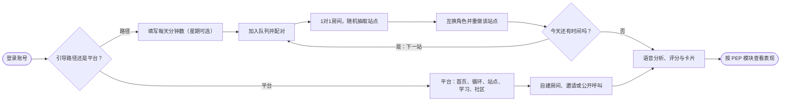
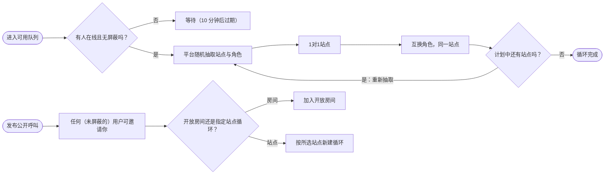
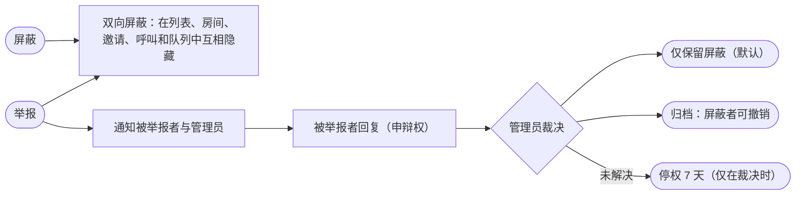
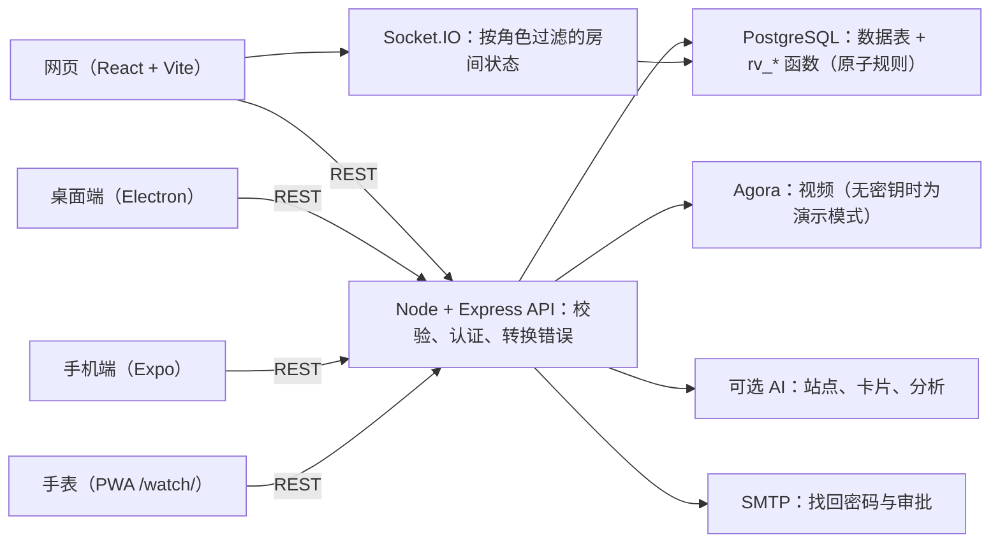

# Revalida Prático 实战手册

_手册、用户旅程、架构、数据与路线图，集于一处_

> 坦诚说明：以下内容均在开发环境（真实 Postgres、自动化浏览器）中测试。尚未在生产环境、实时视频、SMTP、真实 AI、Docker 或原生应用中测试。详见“已测试与未测试”一节。

## 本手册内容

- [总览](#visao)
- [手册地图](#manuais)
- [端到端用户旅程（UX）](#jornada)
- [引导路径](#trilha)
- [随机循环与社区召集](#randomico)
- [社交安全：屏蔽与举报](#seguranca)
- [单人练习、卡牌、播客与 Revalida 电台](#radio)
- [成绩图表反馈](#desempenho)
- [架构与运行](#arquitetura)
- [安装与运维（摘要）](#instalacao)
- [商业与投资人（摘要）](#negocio)
- [已测试与未测试](#testes)
- [交互式路线图](#roadmap)

## 总览

Revalida Prático 是练习 Revalida 实操站的平台：视频房间（主考/评估人、考生、观察员）、由服务器计分的 PEP 清单、语音分析、卡片学习，现在还新增了引导路径、随机循环、社区和成绩图表。

- 一切涉及权限与分数的判断都在服务器/数据库完成，绝不依赖客户端。
- 房间规则存在 PostgreSQL 函数中（原子性）；API 负责校验、转换错误并实时广播状态。
- 房间主考可关闭认知辅助（2D/3D 处置图），以模拟真实考试。

## 手册地图

本手册整合了五份手册，每份仍是各自读者的完整参考：

- **用户手册**（docs/01）：首次登录、房间、考站、学习、账户、常见问题。
- **开发者手册**（docs/02）：仓库、环境、模块、数据库、测试、操作指南。
- **投资人与商业计划**（docs/03）：问题、市场、模式、预测、风险、路线图。
- **技术手册**（docs/04）：架构、授权、会话、实时、安全、运维、局限。
- **安装指南**（docs/05）+ **数据模型**与 **API 参考**（149 个路由）。

## 端到端用户旅程（UX）

登录后的第一个问题很简单：**引导路径**还是**平台**。选择平台，应用照常打开；选择路径，由平台带你训练。流程图展示完整路线，包括安全与反馈。

### 端到端用户旅程（UX）

## 引导路径

- 首次使用时，只需说明**每天可用多长时间**；**星期几为可选项**（不选 = 每天）。
- 之后再次进入时，应用会再次询问：**沿用路径**（自动恢复已配置内容）或**进入平台**。
- 沿用路径时，系统计算**今天还差多少时间**（按圣保罗时区统计已完成考站的分钟数），并加入随机队列；房间会抽取考站直到**填满时间**（每站按 2 倍计，因为角色会互换）。
- 在**同一房间**里一站接一站，搭档从可用人员中随机抽取。若今天不是训练日，应用会提示，仍可选择继续训练。

## 随机循环与社区召集

- **随机循环：**用户进入“可用”状态。一旦有搭档，平台**抽取考站**并**抽取角色**（主考/评估人 × 考生）。1 对 1 完成该站后，角色**互换**，**同一考站再来一次**；随后进入下一个抽到的考站，并重新抽取角色。
- **社区召集：**用户发布公开召集。**任何用户**都可以 (a) **把他加入自己的开放房间**，或 (b) **直接发起**指定考站的循环（召集中的考站或随机抽取）。
- 配对要求：在线、账号有效、未被暂停，且**双方之间没有屏蔽关系**；先认领的人获得该召集（不会重复加入）。

### 随机循环与社区呼叫

## 社交安全：屏蔽与举报

- **屏蔽**是双向的：屏蔽者与被屏蔽者**彼此不再出现**（在线列表、邀请、召集、随机队列、进入房间）。被屏蔽者不会收到通知。
- **举报**包含上述全部效果，并且会**通知被举报人和管理员**。被举报人能看到原因和陈述（**看不到举报人是谁**），并享有**答辩权**。
- **默认：**只有这两个人不再往来。只有在问题**未解决**且**管理员作出决定**（需写明理由）时，才会**暂停账号一周（7 天）**，被暂停者的会话立即失效。管理员账号不会通过此途径被暂停。
- 管理员可以：维持隔离并结案、归档（屏蔽者可自行解除）或暂停（每次新决定再加一周）。所有操作均有审计记录。

### 社交安全：屏蔽与举报

## 单人练习、卡牌、播客与 Revalida 电台

- **AI 单人练习：** AI 在最需要的领域随机选题；你只选难度和时间（默认：站点时长、中等、15 项）。
- **卡牌：** 每张闪卡都是 RPG 卡牌；列表按领域显示全部，每页 10 张；向导可把主题转成卡牌。
- **播客：** 带文字稿的音频播放列表，可自定义提示词、暂停续播，私有链接（你的凭证）或公开链接供播客应用使用。
- **Revalida 电台（radIA.m3d）：** 公开节目并入电台节目单；导出的主题带请求日期留在池中等待同步。

## 成绩图表反馈

**成绩**页面汇总你作为考生完成的考站，并按 PEP 的**通用模块**组织：准备、问诊、体格检查、诊断假设、辅助检查、处置、沟通、转归（以及“其他”）。

- **筛选：**学科、时间段（7/30/90 天、1 年、全部或自定义日期）和**方式**（房间、随机循环、引导路径、社区召集）。
- **图表：**各模块得分（含未达成的关键项）、每周趋势、按方式和按学科；“**重点提升**”标出最弱的三个模块；另有**表格视图**服务读屏用户。
- 把条目归入模块采用的是**启发式规则**（依据章节与描述）；无线索的条目归入“其他”。旧的链接式会话（遗留模型）不计入模块。

## 架构与运行

- **前端：**React 18 + Vite（网页）、Electron（桌面）、Expo（手机）以及手表 PWA。
- **API：**Node 20、Express 与 Socket.IO；按主题分模块（`salas`、`social`、`desempenho`、`estudo`、`estacoes` 等）。
- **数据库：**PostgreSQL 16。房间/循环/角色的状态转换是锁定房间行的 `rv_*` 函数（原子性）。
- **视频：**Agora（无凭据时为演示模式）。**AI：**可选，绝不放在前端。
- **规模：**API 为单实例（Socket.IO 未配置适配器）——已知限制；随机队列每人每 3 秒轮询一次数据库（不使用 socket）。

### 运行原理：架构

### ER 图（实体-关系）

1 = 一 · N = 多 · 虚线 = 通过关联表的关系

```mermaid
erDiagram
  trilhas ||--|| usuarios : "fk"
  chamados }o--|| usuarios : "fk"
  chamados }o--|| salas : "fk"
  notificacoes }o--|| usuarios : "fk"
  denuncias }o--|| usuarios : "fk"
  suspensoes }o--|| denuncias : "fk"
  suspensoes }o--|| usuarios : "fk"
  bloqueios }o--|| usuarios : "fk"
  convites_sala }o--|| salas : "fk"
  convites_sala }o--|| usuarios : "fk"
  sala_participantes }o--|| salas : "fk"
  sala_participantes }o--|| usuarios : "fk"
  salas }o--|| usuarios : "fk"
  salas ||--|| ciclos : "fk"
  ciclos }o--|| usuarios : "fk"
  usuario_estacao }o--|| usuarios : "fk"
  usuario_estacao }o--|| estacoes : "fk"
  cartoes }o--|| temas : "fk"
  cartoes }o--|| estacoes : "fk"
  cartoes }o--|| pep_itens : "fk"
  cartao_progresso }o--|| cartoes : "fk"
  cartao_progresso }o--|| usuarios : "fk"
  ciclos_randomicos ||--|| salas : "fk"
  execucoes }o--|| ciclos : "fk"
  execucoes }o--|| ciclo_itens : "fk"
  execucoes }o--|| usuarios : "fk"
  solicitacoes_papel }o--|| salas : "fk"
  solicitacoes_papel }o--|| usuarios : "fk"
  ciclo_itens }o--|| ciclos : "fk"
  ciclo_itens }o--|| estacoes : "fk"
  transcricoes }o--|| execucoes : "fk"
  analises_transcricao ||--|| execucoes : "fk"
  pep_itens }o--|| estacoes : "fk"
  estacao_temas }o--|| estacoes : "fk"
  estacao_temas }o--|| temas : "fk"
  trilhas {
    string usuario_id PK
    string minutos_dia
    string dias
    string ultimo_modo
  }
  chamados {
    string id PK
    string usuario_id FK
    string sala_id FK
    string tipo
    string area
  }
  notificacoes {
    string id PK
    string usuario_id FK
    string tipo
    string lida_em
  }
  denuncias {
    string id PK
    string denunciante_id FK
    string denunciado_id FK
    string motivo
    string resposta
  }
  suspensoes {
    string id PK
    string usuario_id FK
    string denuncia_id FK
    string inicio
  }
  bloqueios {
    string bloqueador_id PK
    string bloqueado_id PK
    string origem
  }
  convites_sala {
    string id PK
    string sala_id FK
    string convidante_id FK
    string convidado_id FK
    string estado
  }
  salas {
    string id PK
    string dono_id FK
    string ciclo_ativo_id FK
    string estado
    string apoio_cognitivo
  }
  sala_participantes {
    string sala_id PK
    string usuario_id PK
    string papel
    string entrou_em
  }
  usuarios {
    string id PK
    string nome
    string papel_app
    string suspenso_ate
  }
  usuario_estacao {
    string usuario_id PK
    string estacao_id PK
    string vezes_realizada
    string melhor_nota
  }
  cartoes {
    string id PK
    string tema_id FK
    string estacao_id FK
    string pep_item_id FK
    string frente
  }
  ciclos_randomicos {
    string sala_id PK
    string estacoes
    string indice
    string origem
  }
  ciclos {
    string id PK
    string sala_id FK
    string admin_id FK
    string candidato_id FK
    string estado
  }
  execucoes {
    string id PK
    string ciclo_id FK
    string candidato_id FK
    string avaliador_id FK
    string nota
  }
  estacoes {
    string id PK
    string titulo
    string duracao_min
    string status
  }
  cartao_progresso {
    string usuario_id PK
    string cartao_id PK
    string proximo_em
    string acertos
  }
  temas {
    string id PK
    string nome
    string relevancia
  }
  solicitacoes_papel {
    string id PK
    string sala_id FK
    string solicitante_id FK
    string papel_pedido
  }
  ciclo_itens {
    string id PK
    string ciclo_id FK
    string estacao_id FK
    string posicao
  }
  transcricoes {
    string id PK
    string execucao_id FK
    string texto
  }
  pep_itens {
    string id PK
    string estacao_id FK
    string secao
    string pontos_total
  }
  analises_transcricao {
    string execucao_id PK
    string itens
    string gerada_em
  }
  estacao_temas {
    string estacao_id PK
    string tema_id PK
  }
```

## 安装与运维（摘要）

- **Docker：**`bash scripts/instalar.sh --url https://你的域名` 生成安全的 `.env`，启动数据库/API/网页并打印安装码。
- **不用 Docker：**`psql -f db/schema.sql`（幂等；含第 013 号迁移）、API 端 `npm install --omit=dev` 与 `npm start`；网页端 `npm run build`。
- **升级：**`bash scripts/atualizar.sh`（备份 → 按序迁移 → 重建）。摄像头和麦克风**必须使用 HTTPS**。
- 对外开放前，请完成指南中的冒烟测试（30 分钟），并包括：两个账号在队列中配对、一次屏蔽、一次完整的举报流程。

## 商业与投资人（摘要）

- **问题：**Revalida 实操训练需要搭档、评估人和结构化反馈，而这些很难凑齐。
- **方案：**由服务器计分的 PEP 房间、语音分析、学习，以及现在的**自动配对**（路径/随机）和**受管理的社区**，直接解决缺少搭档的问题。
- **模式：**订阅与按考试期次的套餐，面向培训机构的 B2B *（价格仅为假设，需在试点中验证）*。
- **主要风险：**知识产权（INEP）、数据保护（语音/视频）、内容/AI 的临床错误、技术成熟度尚未在生产环境验证。**绝不承诺通过考试。**
- 详情、预测与来源：投资人手册（docs/03）。

## 已测试与未测试

**已测试（开发环境，真实 Postgres 16）：**服务器自动化测试（房间规则、邀请、执行、学习、题库、看板、**社交**、**成绩**）、网页测试（处置引擎、3D 图、设备适配），以及 Chromium 端到端测试（房间、执行、认知辅助、学习、**引导路径、社区、屏蔽/举报与图表**）。数据库结构与迁移已在干净库上执行两次。

**未测试：**真实的 `npm install` 与 `docker compose up`（环境无网络/守护进程）、真实的 Vite 构建、实时视频（Agora）、邮件（SMTP）、真实 AI、Electron、Expo、压力/负载测试，以及**多个真实用户在真实设备上的使用**。随机队列和管理流程仅用模拟账号验证。

**已知限制：**PEP 模块分类为启发式；“在线”= 最近 90 秒内有活动；队列配对通过轮询数据库（不使用 socket）；管理为人工处理（无 SLA 与指标看板）。

## 交互式路线图

| 阶段 · 方向 | 里程碑 | 状态 |
|---|---|---|
| 现在 · 平台 | **房间、循环与角色** — 主考、考生与观察员；考站队列；角色互换；暂停与恢复；在线邀请；PostgreSQL 原子规则。 | 已交付（开发环境已测试） |
| 现在 · 内容 | **考站、学习与语音分析** — 创建、导入（PDF）与审核考站；卡片与学习路径；实时转写与自动校正；分析面板。 | 已交付（开发环境已测试） |
| 现在 · 产品 | **2D/3D 认知辅助** — 动态处置图（发现 → 假设 → 检查 → 处置），可移动、可缩放的面板，支持转为 3D，主考可关闭。 | 已交付（开发环境已测试） |
| 现在 · 商业 | **手册、安装包与图集** — 五份手册、带 SHA-256 校验的安装包、可视化图集，以及这份四语言手册。 | 已交付（开发环境已测试） |
| 本版本 · 产品 | **社区、引导路径与社交安全** — 路径/平台选择、1 对 1 互换的随机循环、公开召集、带答辩权与按周暂停的屏蔽与举报、按 PEP 模块的图表。仍需用真实用户验证。 | 已交付，待生产环境验证 |
| 0–3 个月 · 平台 | **在真实环境中验证** — 在预发布环境运行 Docker、接入真实 Agora 与 AI、SMTP、用户试点、隐私政策与同意书（数据保护）、随机队列压测。 | 下一步 |
| 3–6 个月 · 内容 | **临床审核与班级** — 专家审核考站与认知辅助规则；班级看板（B2B）；报告导出；带时限与指标的管理流程。 | 下一步 |
| 6–12 个月 · 平台 | **规模化与变现** — 支付与套餐、Socket.IO 适配器（多副本）、指标与告警、事件驱动的随机队列、发布原生应用。 | 下一步 |
| 12 个月以上 · 商业 | **生态** — 评估人库、面向机构的主题报告、其他实操考试与更多语言。 | 下一步 |

_唯一来源：docs/playbook/conteudo.py，由 docs/playbook/gerar.py 生成。_
